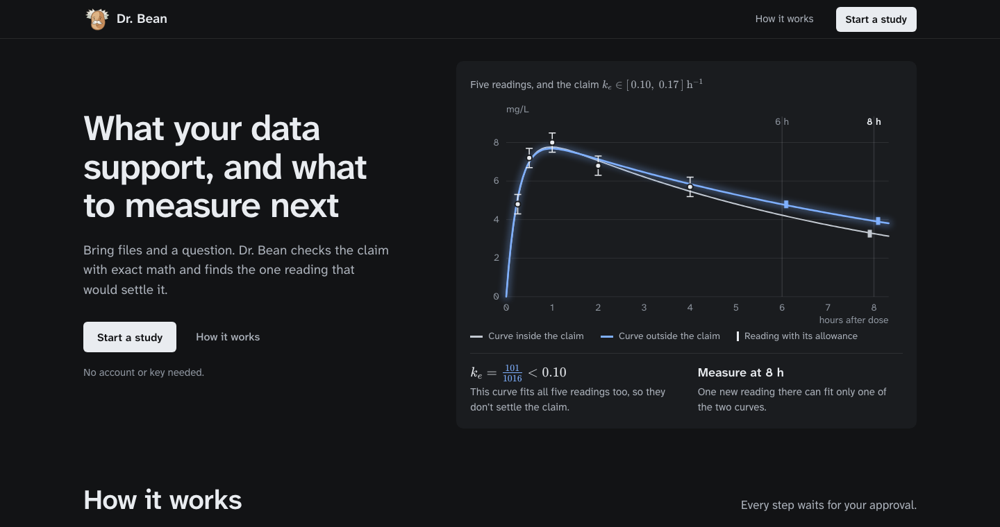
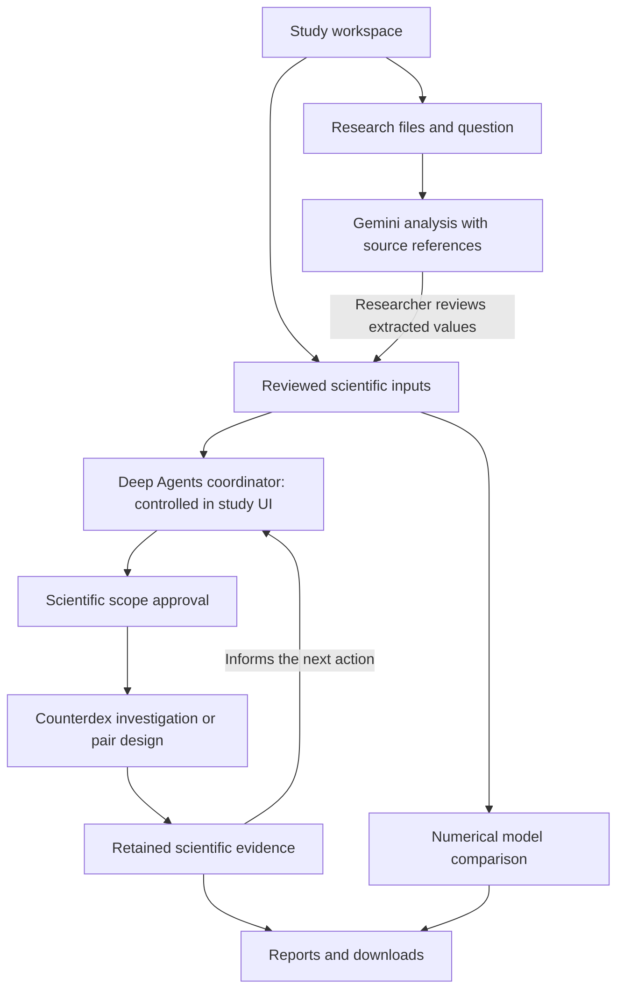

<h1 align="center">Dr. Bean</h1>

<p align="center">
  <strong>Find competing explanations. Decide what to measure next.</strong>
</p>

<p align="center">
  <a href="https://github.com/Arnav-M10/DrBean-hp26/actions/workflows/ci.yml"></a>
  <a href="pyproject.toml"></a>
  <a href="packages/groundwork_adapter/README.md"></a>
</p>

<p align="center">
  <a href="#quick-start">Quick start</a> ·
  <a href="#workflows">Workflows</a> ·
  <a href="#examples">Examples</a> ·
  <a href="#architecture">Architecture</a> ·
  <a href="#documentation">Documentation</a> ·
  <a href="#contributing">Contributing</a>
</p>

Dr. Bean connects research papers and data to a practical scientific question: **could another explanation fit, and what measurement would distinguish it?** It combines file analysis with **Google Gemini**, research coordination with **LangChain Deep Agents**, and deterministic scientific computation with **Counterdex**.

A convincing curve is only a starting point. For its supported concentration model, Dr. Bean can discover a competing parameter assignment, check that it satisfies every reviewed measurement bound, and retain the evidence for replay. Researchers can then compare follow-up measurements that distinguish two retained candidates.

The main interface is the **study workspace** at `/study/app`, introduced by a front page at `/study/` in a local checkout. Researchers bring files and a question, review the proposed analysis, inspect the answer, and choose a next step. Supported scientific checks retain the reviewed inputs, assumptions, computation, and evidence needed to inspect or replay a result.

The [hosted prototype](https://drbean.study/) opens its study app at `/study/app`. Vercel serves the landing page and proxies the app to the development host; the API, worker, database, and provider key remain on that host. Availability depends on that host and its tunnel. The hosted frontend can differ from a fresh clone. See [deployment details](deploy/landing/README.md).

<p align="center">
  
</p>

The landing illustration shows a saved synthetic example, not a new computation.

## Workflows

| Workflow | Input and method | Output |
| --- | --- | --- |
| **Research file analysis** | A question with PDFs, images, CSV, TSV, JSON, text, or Markdown; Gemini interprets selected material after consent. | AI interpretation, source references, extracted tables, limitations, and suggested next steps. Quotes are checked for occurrence where a usable text layer exists; unmatched or uncheckable quotes are labelled. Values and interpretations still require review. |
| **Parameter-claim investigation** | Reviewed time–concentration measurements, hard allowances, a supported model, and a claimed parameter interval. | Discovered candidates, exact compatibility checks, an outside witness when found, and replayable native evidence. |
| **Next-measurement design** | Two retained candidates, feasible measurement times, and a reviewed future hard allowance. | A checked separation result for the fixed pair when supported, or an explicitly numerical or inconclusive result. |
| **Numerical model comparison** | Reviewed synthetic electron-current observations and an idealized collector response. | Isotropic versus gyrotropic bi-Maxwellian fits, residuals, noise sensitivity, conditional Monte Carlo results, and candidate measurement settings. |

General file analysis can address questions across disciplines. Exact scientific verification applies to the supported mathematical model; numerical comparisons and AI explanations have their own stated scope.

### Core capabilities

- **Review before execution.** Scientific operations bind to the exact inputs and assumptions the researcher approved. Changed inputs require a new review.
- **Evidence-dependent planning.** The Deep Agents coordinator maintains a plan, invokes scoped tools, reads returned scientific evidence, and proposes a next action. The main study UI uses its controlled offline policy; live coordination has separate implementation and qualification limits described below.
- **Readable results.** Reports explain the question, finding, conditional meaning, uncertainty, and next step. Exact values and machine-readable records remain available.
- **Persistent investigations.** Private workspaces retain sessions, approvals, events, reports, and scientific artifacts on the host. Committed actions support reconciled checkpoint continuation. Browser access expires after 24 hours by default; identity recovery is not implemented. Download evidence you want to keep accessible.
- **Reproducible evidence.** Exact-check packets retain rational inputs and separately supplied replay anchors. Numerical results retain their assumptions and provenance.
- **Shared Gemini access.** One server key serves authorized browser workspaces through a shared request ledger. Keys stay out of browser code and the repository.

## Quick start

**Requirements:** macOS or Linux, `python3` for the launcher, [uv](https://docs.astral.sh/uv/), and Node.js 20 or newer. The launcher prepares the backend on Python 3.12/3.13 and the exact checker on CPython 3.11. CI uses Node.js 22.

```bash
git clone https://github.com/Arnav-M10/DrBean-hp26.git
cd DrBean-hp26

scripts/dev/setup.sh
scripts/dev/start.sh
```

Open **<http://127.0.0.1:4173/study/#data>**, or append `/study/#data` to the web address printed by the launcher when using a different port. Browser access uses an automatically established private session; researchers do not copy an access token or Gemini key into the interface.

A fresh checkout runs without a model-provider key. The scientific examples use real computations; the default controlled coordinator is an offline policy running through the actual Deep Agents graph. Live Gemini requires the server configuration described below.

```bash
scripts/dev/doctor.py       # Inspect service and runtime readiness
scripts/dev/stop.sh         # Stop launcher-managed services; retain saved work
```

See [Getting started](docs/getting-started.md) for Gemini setup, shared access, alternate interfaces, and recovery.

## Examples

### Challenge a parameter interval

In the study workspace, select **drug levels after a dose**, or import a table with time, concentration, and hard-allowance columns. The supported exact model is

$$
C(t)=A\left(e^{-k_e t}-e^{-k_a t}\right),
\qquad A>0,\quad 0<k_e<k_a.
$$

For the synthetic example, ask whether the measurements force the elimination rate into the closed interval $k_e\in[0.10,0.17]\;\mathrm{h}^{-1}$. Review the measurements, assumptions, and proposed scope, then approve the scientific operation.

The example has compatible parameter assignments outside the claimed interval. A verified outside witness establishes that the reviewed assumptions do **not** force the claim; it does not identify the true physical parameters. A subsequent design can compare two retained candidates at separately reviewed measurement times.

The [decision example](packages/groundwork_adapter/docs/DECISION_EXAMPLE.md) documents the calculation. The [portable replay example](packages/groundwork_adapter/fixtures/repro/README.md) includes a native packet and its matching anchors.

### Compare electron-distribution models

Select **electron currents at a collector**. Review the synthetic observations, collector geometry, model bounds, and noise assumptions before comparing an isotropic Maxwellian with a gyrotropic bi-Maxwellian having parallel and perpendicular temperatures.

The numerical workflow shows where fitted predictions differ and whether the difference exceeds the selected noise criterion. Its planar response is an idealized synthetic example, not a calibrated experimental instrument. See the [comparison walkthrough](workspace-preview/README.md#numerical-plasma-comparison-walkthrough).

### Run numerical comparison without the application

The separate `counterdex-models` package provides bounded fitting, sensitivity analysis, seeded Monte Carlo, and finite-grid measurement ranking for registered models:

```bash
.venv-engine/bin/python packages/counterdex_models/examples/demo.py
```

This provider-free example compares single- and two-exponential models under different observation windows, noise assumptions, and detection thresholds. See the [package documentation](packages/counterdex_models/README.md) for request schemas and model registration.

## Architecture



The FastAPI service owns workspace access, input revisions, approvals, provider accounting, and retained records. A supervised worker executes the research graph and scientific jobs. SQLite stores application records and LangGraph checkpoints.

Deep Agents supplies the planning and tool-execution graph. The application exposes six tools: `write_todos`, `prepare_scientific_proposal`, `run_scientific_operation`, `read_research_evidence`, `request_clarification`, and `publish_research_report`. Scientific dispatch pauses at a canonical approval boundary. The coordinator uses these tools rather than unrestricted shell access or a general-purpose subagent.

Counterdex constructs exact enclosures for selected parameter vectors in the supported two-rate model. The numerical comparison layer is separate: a fit, model ranking, or Monte Carlo frequency is not an exact Counterdex certificate.

### Execution and evidence

| Mode or result | Interpretation |
| --- | --- |
| **Controlled coordinator** | Deterministic offline model driving the actual graph, worker, and scientific tools. It makes no provider calls. |
| **Live Gemini** | Configured server-side model calls with consent, admission, and shared accounting. Readiness and live qualification are separate facts. |
| **Exact scientific check** | Checks named fixed vectors against the reviewed model and hard bounds, and determines whether each lies outside the claimed interval. |
| **Numerical comparison** | Conditional numerical results for the registered models, supplied observations, and noise assumptions. |
| **Native replay** | Fresh execution of the matching checker against retained bytes and independent expected identities. It is not a second proof system. |

The main study UI starts the **controlled coordinator**, including when Gemini file analysis is enabled. The separate classic interface supports live Gemini coordination with server configuration, session consent, and an operator allocation. A [live run at `0cebdd4`](evaluation/results/sprint/validator-2026-11-15/report.md) completed with **four Gemini requests**: Deep Agents prepared a plan, paused for approval, ran the approved Counterdex check, and published a report with validated commentary.

That single run does **not** establish a fully qualified autonomous release. The live commentary-failure path was not exercised, and the validator did not freshly replay its downloaded native artifact, although the application's replay passed. The agent stopped after reporting; next-measurement design remained a separately requested action. Earlier retained attempts failed [narration validation](evaluation/results/sprint/combined-5a028f1.json) and [tool-argument validation](evaluation/results/sprint/live-final-17c7f7a/qualification.json). These records describe their tested revisions, not fresh tests of every later commit.

Strict offline qualification has passed on earlier named revisions, including [the macOS record at `c4d1ad6`](docs/release-evidence/offline-c4d1ad6-macos.json). Those results do not automatically qualify the current revision or live Gemini. The server reports configuration and readiness alongside static qualification labels; consult the commit-bound records for executed outcomes. Live file analysis is implemented, but the offline results and coordinator records do not establish its general extraction accuracy.

General paper interpretation does not certify arbitrary mathematical proofs, and a bounded search that finds no counterexample does not prove a universal claim. The authored Riemann-paper example checks a synthetic two-rate numerical premise inside that paper; it does not check or disprove the Riemann hypothesis.

## Gemini configuration

The launcher reads an owner-only `var/gemini.local.json` file. It deliberately does not inherit provider keys from the shell. To prepare the disabled template after setup:

```bash
cp scripts/dev/gemini.local.example.json var/gemini.local.json
chmod 600 var/gemini.local.json
```

Configure the server-side key and explicit opt-in, then restart the launcher to enable Gemini file analysis. This does not change the study workspace's controlled coordinator. The separate live-coordination API requires matching server configuration, current session consent, and an operator allocation. [Configuration instructions](docs/getting-started.md#configure-gemini) describe both paths and the UI limitation.

The free-tier flag records the operator's project declaration; it does not verify Google billing or guarantee a dollar-denominated cap. Shared accounting limits application requests, including failed or uncertain attempts, without automatic retries or model fallback.

## Development

Run setup before using the managed backend and engine environments. Routine checks are provider-free:

```bash
export BEAN_COUNTERDEX_PYTHON="$PWD/.venv-engine/bin/python"
export BEAN_COUNTERDEX_REPLAY_PYTHON="$PWD/.venv-engine/bin/python"
export PATH="$PWD/.venv-engine/bin:$PATH"
export PYTHONPATH="$PWD/packages/counterdex_models"

uv run ruff check apps tests scripts
uv run pytest -q tests --ignore=tests/integration
.venv-engine/bin/python -m unittest discover -s packages/groundwork_adapter/tests
.venv-engine/bin/python -m unittest discover -s packages/counterdex_models/tests
node --test apps/web/*.test.mjs apps/web/study/*.test.mjs
node --test workspace-preview/tests/*.test.mjs
```

Some backend tests need the prepared engine interpreter. The [development instructions](docs/getting-started.md#development-checks) include the relevant environment variables and browser-test setup. [CI](.github/workflows/ci.yml) additionally exercises contracts, browser workflows, process boundaries, and the evaluation harness on macOS and Linux. Offline CI does not qualify live Gemini.

### Repository layout

| Path | Responsibility |
| --- | --- |
| [`apps/web/study/`](apps/web/study/) | Main study interface: Data, Approval, Answer, and Next step. |
| [`apps/api/bean_api/`](apps/api/bean_api/) | API, durable worker, research coordination, file analysis, and model comparison. |
| [`packages/groundwork_adapter/`](packages/groundwork_adapter/) | Counterdex exact checker, native evidence, and application adapter. |
| [`packages/counterdex_models/`](packages/counterdex_models/) | Separate bounded numerical model-comparison library. |
| [`shared/contracts/`](shared/contracts/) | Versioned request, response, and evidence schemas. |
| [`evaluation/`](evaluation/) | Independent checks, retained evidence, and qualification tooling. |
| [`scripts/`](scripts/) | Setup, service management, sharing, and release checks. |
| [`workspace-preview/`](workspace-preview/) | Additional connected research/comparison views and labelled static examples. |
| [`deploy/landing/`](deploy/landing/) | Curated public landing-page snapshot and Vercel routing to the running development host. |

## Documentation

- **Use the application:** [Getting started](docs/getting-started.md), [study workspace](apps/web/study/README.md), [shared server](docs/shared-server.md).
- **Integrate services:** [research-file API](docs/general-research/api.md), [research contracts](shared/contracts/DB-RESEARCH-1/README.md), [scientific contracts](shared/contracts/README.md).
- **Understand the computation:** [Counterdex](packages/groundwork_adapter/README.md), [numerical model comparison](packages/counterdex_models/README.md), [decision example](packages/groundwork_adapter/docs/DECISION_EXAMPLE.md).
- **Inspect qualification:** [evaluation harness](evaluation/README.md), [preferred-research evidence](docs/frontend/preferred-research/README.md), [release runbook](docs/release-runbook.md).

## Contributing

Use [GitHub Issues](https://github.com/Arnav-M10/DrBean-hp26/issues) for reproducible bugs and proposed changes. Include the relevant workflow, configuration mode, expected behavior, and a small public or synthetic input. Exclude credentials, private research material, and local stores.

Contributions should preserve the distinctions among model commentary, numerical analysis, and exact scientific evidence. Extend supported models through explicit contracts and tests; keep the scientific engine independent of provider credentials and the web interface. Open a pull request with the change, its scientific scope, and the checks performed.

## Referencing the project

Dr. Bean is a research prototype developed for HackPrinceton 2026. To reference a particular implementation, include the repository URL and the commit used for your experiments.

```bibtex
@software{drbean2026,
  author = {{Dr. Bean contributors}},
  title  = {{Dr. Bean}: Scientific Model Comparison and Checkable Evidence},
  year   = {2026},
  url    = {https://github.com/Arnav-M10/DrBean-hp26}
}
```
